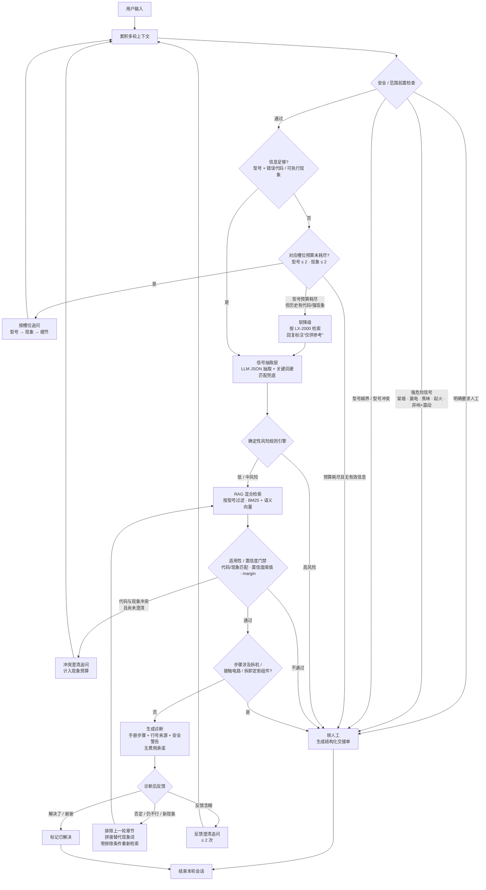

# 售后智能分诊 Agent 系统（After-sales Triage Agent）

> 基于 RAG + 可审计状态机（生产化路线：LangGraph）的工业设备故障智能分诊助手：先判断信息是否足够，再做安全预判、手册检索与答案门禁，最终输出可追溯的诊断步骤或转人工交接单。

> **实现说明：** 当前 v1 使用自研确定性状态机完成 LangGraph 同等的节点编排，尚未直接依赖 LangGraph；迁移计划见[技术栈](#3-技术栈)与[下一步](#9-已知限制与下一步)。README 不把规划中的技术写成已实现能力。


---

## 1. 项目简介

这是一个面向打印机售后场景的工单分诊 Demo。用户用自然语言描述故障，例如：

- “机器坏了”
- “LX-2000 显示 E01 不出纸”
- “冒烟了”
- “打印一半停了”

系统会：

1. **判断信息是否足够**：确认型号，并拿到错误代码或可执行故障现象；型号与故障现象使用**独立追问预算**（各 2 次），没有全局“总追问次数”截断；
2. **优先做安全预判**：冒烟、漏电、焦味、起火、异响带震动等危险信号不要求先确认型号，直接进入安全转人工路径；
3. **执行确定性风险判定**：LLM 只提取风险/现象信号，最终风险等级由规则引擎决定；
4. **检索维修手册**：只从 `printer_LX2000.md` 的适用章节中召回内容；
5. **通过适用性与置信度门禁**：型号、代码、现象、top-1/top-2 间距任一不满足就转人工；
6. **生成有来源的诊断步骤**：回答只复述命中的手册步骤，标注文件名和行号，不生成费用/保修承诺；
7. **保持诊断后的反馈闭环**：诊断后会话不结束，用户可以否定结论、补充新现象或确认已解决；否定时排除上一轮章节并重新检索，只有明确解决或转人工才结束会话；
8. **必要时转人工**：输出结构化交接单，包含用户原文、已提取槽位、风险证据、候选文档和推荐队列。

项目的核心目标不是“让 LLM 自由回答”，而是把售后分诊做成**可解释、可回归测试、危险场景优先**的确定性流程。

### 核心特性（亮点）

- **混合检索**：中文 bigram BM25 + 字符 trigram 语义相似度融合，兼顾“E01 / LX-2000 / 卡纸”等精确关键词和“纸出不来了 / 卡在里头”等口语改写；检索结果仍须通过型号、代码、现象类别、置信度与 top-1/top-2 margin 五重门禁。
- **LLM 槽位抽取**：DeepSeek 只做受约束的风险信号与故障现象抽取，逐字校验 `evidence`、拦截否定语境；槽位归一化、追问预算和最终路由全部由确定性代码掌控，模型不生成维修步骤。
- **安全风险拦截**：冒烟、漏电、焦味、起火、异响带震动等信号在检索前触发安全转人工，不要求先确认型号；高风险工单只输出即时安全指引，不输出维修步骤，并进入 `safety_escalation` 队列。
- **软降级策略**：型号追问预算耗尽但已有错误代码或可执行现象时，按 LX-2000 检索并明确标注“型号未确认、仅供参考”；LLM 超时、限流、非 JSON、输出截断时自动回退关键词通道，主流程不中断。
- **可回归评测**：82 个单元/场景测试 + 34 条端到端用例，规则通道与真实 DeepSeek 通道双跑对比，行为差异可量化。

---

## 2. 核心架构



> **顺序说明：** 本实现把风险判定放在 RAG 检索之前。危险工单不应先经过维修步骤检索，这是有意的安全设计，而不是流程图绘制顺序。

### 状态机说明

- **确定性状态机**：每个阶段都有显式出入口和可测试分支，不是自由运行的 Agent 循环。
- **动态槽位重校验**：每轮都把 `conversation_history` 中的全部用户消息重新合并抽取，而不是只解析最后一句话；型号、错误代码、故障现象、电源状态、故障阶段都可能由前几轮共同补全。
- **指代消解与槽位持久化**：用户回复“是 / 对 / 没错”时，结合上一轮 assistant 的待答槽位解析。例如系统刚问“是否为 LX-2000”，用户答“是”，型号槽位即确认；确认结果会写回会话状态，后续轮次即使用户历史文本中没有“LX-2000”字样，也不会再次追问型号。
- **同义现象映射**：“打到一半停住”“出一半卡了”“印一半断了”统一归为打印中断，并映射到手册 E08 章节；这些表达不再触发“请描述故障现象”的重复追问。
- **短路机制**：只要型号已匹配且现象/错误代码明确，立即跳过所有追问进入检索与诊断。
- **独立追问预算**：`model_ask_count ≤ 2`、`fault_ask_count ≤ 2`、`feedback_ask_count ≤ 2`，没有全局总次数上限。已问过型号不会阻止用户后来补上的现象被使用；代码/现象冲突澄清计入现象预算。
- **软降级**：型号 2 次仍未确认，但历史里已有明确错误代码或可执行现象时，不转人工；按 LX-2000 检索，并在回复开头明确标注“基于 LX-2000 型号为您提供参考”。只有完全没有有效故障信息时才转人工。
- **诊断后反馈闭环**：`diagnose` 不再结束会话，而是进入 `in_follow_up` 状态。用户说“没提示纸张错”“还是不行”“不对”等否定反馈时，系统排除上一轮诊断章节（代码与 `source_id` 双重排除），并把 E19/E10 等替代现象词拼入检索 Query；连续否定会累积排除，避免 E08/E19 来回反弹。反馈含糊时使用独立的反馈追问预算，不重新问型号。若上一轮诊断时型号只是通过“是”确认，型号会持久化到会话状态，反馈轮不会因历史文本缺少型号而错误转人工。
- **诊断后三类意图路由**：`resolved`（好了/解决了）结束会话；`denial`（没显示/不对/还是不行）触发带排除条件的重检索；`progress`（拿出来了/打开了/然后呢/下一步/按钮在哪）**不重新检索**，直接基于当前章节返回剩余步骤，并返回 `guide` 动作。含糊回复才进入反馈追问。
- **真正结束的条件**：只有用户明确说“解决了 / 谢谢”、明确要求人工，或反馈预算耗尽后转人工，才进入 `END`。已解决返回 `resolved`，不生成交接单。
- **安全预占**：强危险信号、明确人工请求、型号越界可以在信息不足或诊断后反馈阶段直接结束流程。

---

## 3. 技术栈

本仓库当前是**可离线运行的 v1 参考实现**；LangChain / LangGraph / FAISS / BGE 是生产化升级目标，尚未在当前代码中实际引入。下表明确区分“现在能跑的实现”和“目标技术栈”，避免 README 与代码不一致。

| 层级 | 当前 v1 实现 | 生产化目标 |
|---|---|---|
| 语言 | Python 3.10+（开发环境 3.12） | Python 3.12 |
| Agent 编排 | 自研确定性状态机（`agent_workflow.py`） | **LangGraph 1.x** |
| RAG 编排 | 自研检索管线（`rag_engine.py`） | **LangChain 1.x** |
| 稀疏检索 | 中文字符 bigram BM25 + 领域词加权 | BM25 |
| 稠密/语义检索 | 字符 trigram TF-IDF 余弦（零依赖替代） | **BGE Embedding + FAISS** |
| LLM | **DeepSeek API**（`deepseek-chat`，OpenAI SDK） | DeepSeek API |
| 评测 | 自定义 JSON Suite + unittest | 同一 Suite + CI 回归 |

**当前实现的技术选择：** 为了零第三方依赖、离线可运行和全链路可解释，v1 使用原生 Python 实现状态机与检索；DeepSeek 是唯一可选的外部服务。生产化替换为 LangGraph / LangChain / BGE / FAISS 时，状态、门禁和风险规则保持不变。

---

## 4. 核心设计决策

### 4.1 为什么用混合检索（向量 + BM25）

中文售后描述通常很短，且同时包含自然语言现象、型号和错误代码。单一检索方式不够稳定：

- **BM25 擅长精确匹配**：对“E01”“LX-2000”“卡纸”这类关键词敏感，适合作为主召回通道，保证错误代码和型号不会被语义模型稀释。
- **向量检索擅长语义泛化**：用户可能说“纸出不来了”“进不去”“卡在里头”“堵住了”，但手册写的是“卡纸”。BGE Embedding + FAISS 能覆盖这种同义改写。
- **两路互补**：BM25 解决“词对了但语义漂移”，向量解决“语义对了但词没对上”；融合后再叠加代码、标题、现象类别的可解释加权。
- **检索后仍然要过门禁**：分数最高不等于可回答。系统还会校验型号匹配、错误代码一致、故障现象类别匹配、置信度阈值与 top-1/top-2 margin，任一不满足就转人工。

> **v1 实现说明：** 当前代码中的语义通道是**字符 trigram TF-IDF 余弦**，不是 BGE 向量；它让项目在无模型、无网络、无向量库的情况下也能运行。迁移到 BGE + FAISS 时，融合策略和门禁逻辑不变。

### 4.2 为什么安全预判优先于型号追问

售后场景中，最危险的不是“答错型号”，而是**在用户已经报告冒烟、漏电、起火时还在追问型号**。

- 冒烟、漏电/触电、烧焦/焦味、起火/明火、异响并伴随震动等强危险信号**不要求型号**，直接进入安全转人工路径；
- 用户明确要求人工时，任何节点都可以立即转人工；
- 高风险只给“停止使用、远离设备、在安全前提下断电、不要重新通电/拆机”等即时安全指引，不给维修步骤；
- 高风险工单进入 `safety_escalation` 队列，交接单保留风险信号、证据和规则 ID，方便人工优先处理。

这条规则优先于“槽位完整性”和“独立追问预算”策略。安全路径不是异常分支，而是主流程的前置门禁。

### 4.3 为什么 LLM 只负责抽取信号，风险最终由规则引擎判定

LLM 适合理解口语，但不适合承担安全责任。

- **风险等级必须可审计、可回归测试**：最终等级由 `RiskEngine` 依据类别集合和规则 ID 计算，不直接采信模型结论；
- **LLM 只做受约束的抽取与选择**：风险信号、故障现象类别，以及诊断后反馈意图（`solved` / `denial` / `progress` / `unclear`）；不输出风险等级，不自由生成维修建议，不决定检索结果。progress 时 LLM 只能从当前手册章节的步骤编号中选择，最终步骤仍由确定性代码校验并按手册原文展示；
- **逐字证据校验**：模型返回的 `evidence` 必须能在用户原文（归一化、去标点后）中找到，否则丢弃；“没有冒烟”这类否定语境也会被规则层拦截；
- **关键词通道始终运行**：LLM 未配置、超时、拒答、返回非 JSON、输出被截断时，自动降级为关键词兜底，工单流程不中断；
- **关键词硬匹配兜底**：即使 LLM 漏掉“冒烟”“漏电”等必须升级的词，确定性规则仍会触发高风险；
- **回答不由 LLM 自由生成**：诊断步骤只来自命中的手册章节，LLM 不参与最终维修内容创作。

一句话：**LLM 负责“听懂用户说了什么、可能处在哪一步”，规则引擎负责“决定系统做什么、是否允许继续”。**

### 4.4 为什么用“独立槽位预算 + 软降级”而不是全局追问上限

早期实现使用单一 `follow_up_count`，最多追问 3 次。它在真实多轮对话里会出现三个问题：

1. **死板截断**：用户在第 3 轮已经补齐型号和现象，但全局计数刚好到上限，系统仍然转人工；
2. **忽略历史**：用户第一句说“打到一半出不来了”，系统问型号，用户答“是”，系统却只解析最后一轮的“是”，把第一句现象丢掉，继续追问故障现象；
3. **没有逃生通道**：型号始终问不出来时，即使历史里已经有 E01 或“卡纸”，也只能转人工。

重构后：

- **按槽位计数**：`model_ask_count` 和 `fault_ask_count` 各自最多 2 次，互不挤占；`follow_up_count` 只作为交接单审计字段，不再参与路由。
- **每轮全量重抽取**：所有用户消息重新合并，再叠加指代消解与同义映射，保证前几轮的信息不会因最后一句话而丢失。
- **型号软降级**：型号预算耗尽但存在明确代码或可执行现象时，按 LX-2000 检索，并在回答与交接单中明确标注“型号未确认、仅供参考”；只有完全没有任何有效故障信息才转人工。
- **现象预算耗尽才转人工**：型号已确认（或已软降级）但现象两次追问仍不明确，才以 `insufficient_info` 转人工。

这套策略把“追问”从全局倒计时改成了**按信息缺口分别管理**，避免用户已经给出答案却因为计数错误被转人工。

### 4.5 为什么诊断后必须保留反馈闭环

早期实现把 `diagnose` 当作会话终点：系统一输出建议就设置 `finished=True`，用户再说“我没有这个现象”或“还是不行”，下一条输入会触发 `reset()`，系统重新追问型号。这违背真实售后排查的基本节奏——**用户需要拿着建议去试，再回来反馈**。

重构后的闭环：

1. **生命周期**：诊断只写入 `last_diagnosis_*` 并设置 `in_follow_up=True`，不结束会话；只有 `resolved`、`handoff` 或反馈预算耗尽才结束；
2. **否定识别**：`taxonomy.analyze_feedback()` 确定性识别“没显示 / 没有 / 不对 / 还是不行 / 不是 E08”等表达，同时区分“解决了 / 谢谢”和“解决了，但是又卡纸了”这类转折句；
3. **带排除条件重检索**：把上一轮诊断的代码和 `source_id` 传给 `ManualIndex.search(exclude_codes=..., exclude_source_ids=...)`，被否定章节不参与打分，也不会影响 BM25 归一化；
4. **替代现象扩展**：仅排除 E08 会让 BM25 找不到足够强的候选，因此按上一轮故障拼接 E19/E10 的手册词汇（如“纸张皱 卡下一张”“异响 震动 咔咔”）；这是从拒答走向重新命中的关键；
5. **二次检索单独放宽门禁**：首次诊断仍使用 `0.68` 置信度与 `0.05` margin；否定反馈后的第二次检索使用 `0.40` 置信度阈值并允许并列候选，只要还有可适用章节就继续给出排查步骤，而不是直接转人工。低于 `0.40` 或没有可适用章节时才进入反馈追问/转人工；
6. **累积排除 + 有界重试**：连续否定会累积排除，防止 E08 ↔ E19 循环；重新检索失败或反馈含糊时最多追问 2 次，之后以 `feedback_unresolved` 转人工，并在交接单记录 `excluded_codes` / `excluded_source_ids`；
7. **进度推进不重新检索**：用户说“拿出来了，然后呢，怎么做”时，系统保持当前诊断（例如 E19），跳过检索，直接从同一手册章节继续输出未完成步骤（如检查纸张受潮、调整导板、打印测试页），返回 `guide`。确定性 regex 先识别动作；LLM 只作为未识别同义表达的兜底，并且只能选择手册中已有步骤编号。

典型链路：

```text
用户：LX-2000 打印一半停了
系统：diagnose E08（会话保持打开）

用户：没提示纸张错
系统：识别否定 → 排除 E08 → Query 拼接“打印中断 打到一半停住 纸张皱 卡下一张”
      → diagnose E19（仍保持打开）

用户：拿出来了，然后呢，怎么做
系统：guide E19，不重新检索，继续输出第 3–5 步
      （检查纸张受潮/卷曲、调整纸盒导板、打印测试页）

用户：解决了
系统：resolved，真正结束会话
```

### 4.6 其他关键取舍

- **诊断内容 grounded**：回答带 `printer_LX2000.md` 行号、代码和标题；无可用步骤时转人工。
- **手册高风险 ≠ 工单高风险**：用户未报告危险信号时，手册中的高风险章节可以给步骤，但必须在步骤前展示显著安全警告；涉及拆机、接触电路或拆卸定影组件的步骤直接转人工。
- **不承诺费用**：过滤“免费、保修、价格、收费、赔付、保证、一定能”等词；过滤后无可用步骤则转人工。
- **交接单可落地**：包含原因码、推荐队列、用户消息、已提取槽位、风险证据、候选文档和手册来源，可通过 `--save-tickets` 落盘。

---

## 5. 评测数据

### 5.1 评测集

`evaluation/test_cases.json` 内置 **34 条**端到端行为用例：

| 场景类别 | 数量 | 覆盖点 |
|---|---:|---|
| 信息不足 | 6 | 缺型号、缺现象、独立槽位预算耗尽后转人工、现象表达不完整 |
| 信息足够 | 11 | 卡纸、错误代码、字迹异常、连接/进纸问题；多轮补全、代码更正、E08 同义表达 |
| 高风险 | 6 | 冒烟、漏电、烧焦味、起火、异响带震动、机器很烫 |
| 不支持/无匹配 | 6 | 超范围型号、型号冲突、未知代码、代码与现象冲突、低置信度 |
| 诊断后反馈闭环 | 5 | E08→E19 否定重检索、仅说“还是不行”、E02→E10 新现象改判、明确解决、反馈预算耗尽转人工 |
| **合计** | **34** | 其中包含 4 条边界用例 `BOUND-01`～`BOUND-04` 和 5 条反馈用例 `FB-01`～`FB-05` |

评测直接检查 `TurnResult` 的结构化字段（`action`、`ticket.reason_code`、`risk.level`、`sources`、`model_ask_count`、`fault_ask_count`、`feedback_ask_count`、`diagnosis_count`、`excluded_codes`、`follow_up_count`、`asked_slots` 等），不通过回答文本猜测系统行为。各计数通过轨迹前缀 `C:ask(model#N)` / `C:ask(fault#N)` / `C:ask(feedback#N)` 交叉校验，避免“总次数没超但某个槽位被重复追问”。

```bash
# 离线规则通道
python evaluation/evaluate.py

# 真实 DeepSeek 双通道对比
python evaluation/evaluate_llm.py

# 只跑某个 Case
python evaluation/evaluate_llm.py --case BOUND-04 --verbose
```

### 5.2 评测结果

全项目测试规模：**116 项**（82 个单元/场景测试 + 34 条端到端用例），超过 35 项；端到端用例同时运行**离线规则通道**与**真实 DeepSeek 通道**，并逐字段对比行为差异。

| 通道 | 通过率 | 说明 |
|---|---:|---|
| 离线规则通道 | **34/34（100%）** | 可重复、无外部依赖 |
| 真实 DeepSeek 通道 | **34/34（100%）** | 2026-10-28 复跑；每条 Case 运行 1 次，记录原始抽取 JSON |
| 行为差异 | **0 条** | 重构后规则与 LLM 通道行为一致 |
| LLM 调用失败 | **0** | 无超时、拒答或非 JSON 返回 |

> 这里的 100% 是**该 34 条评测集上的通过率**，不是生产环境的泛化准确率。样本量、单次 LLM 运行和单手册覆盖仍是限制，正式上线前需要扩充评测集并做多轮统计。

### 5.3 BOUND-04：规则通道 vs 真实 LLM

输入：

```text
LX-2000 打印一半停了
```

这条用例最初是为了暴露**关键词盲区**：

| 版本 | 规则通道 | 真实 LLM 通道 | 说明 |
|---|---|---|---|
| 重构前 | `ask`（追问“故障现象”），1 次 | `diagnose` / E08，0 次 | LLM 将“打印一半停了”抽为 `paper_output`，补齐槽位后确定性命中 E08 |
| 重构后 | `diagnose` / E08，0 次 | `diagnose` / E08，0 次 | 规则层加入 E08 同义映射，两通道收敛 |

重构前的 LLM 原始抽取记录（历史对比证据）：

```json
{
  "symptoms": [
    {
      "category": "paper_output",
      "evidence": "打印一半停了",
      "negated": false
    }
  ],
  "uncertain": false
}
```

这说明 LLM 确实能补足关键词盲区，但也会引入行为波动。重构时没有把这类同义表达继续留给 LLM 兜底，而是在确定性层补齐：

- “打到一半停住”
- “出一半卡了”
- “印一半断了”
- “打印一半停了”

这些表达统一映射为 `paper_mismatch`，并生成 `inferred_code_hint = E08` 参与检索（与用户明确输入的 `error_codes` 分开记录）。因此规则通道不再追问，LLM 通道也保持同样结果。

`BOUND-04` 现在的职责从“允许两种结果”变成了**回归门禁**：任何一侧退回到重复追问，都会被评测判失败。当前 `evaluation/llm_report.json` 中该用例的 LLM 调用只剩风险抽取（`signals: []`），因为确定性现象抽取已经先行命中，无需再调用现象抽取模型。

### 5.4 与单元测试的区别

`tests/` 下另有 **82 个**单元/场景测试，覆盖手册解析、检索命中与冲突、排除式检索、风险判定、LLM 证据校验、DeepSeek 请求形状与降级、独立槽位追问预算、指代消解、E08 同义映射、软降级、代码更正、诊断后否定反馈、累积排除、诊断后进度推进/动作识别、解决态会话结束、LLM 意图 Prompt、专业步骤拦截、引用来源和费用承诺过滤。

```bash
python -m unittest discover -s tests -v
```

单元测试验证模块契约，34 题评测集验证端到端行为，两者不能互相替代。

---

## 6. 快速开始

### 6.1 三步运行

```bash
# 1. 可选：安装 LLM 依赖并创建本地配置
pip install -r requirements-optional.txt
cp .env.example .env

# 2. 编辑 .env，填入 DEEPSEEK_API_KEY=<your-deepseek-key>
#    未配置时自动使用关键词/规则通道，仍可完整运行

# 3. 启动交互式分诊（诊断后可继续反馈）
python main.py
```

### 6.2 环境要求

- Python 3.10+（开发环境为 3.12）
- 离线模式：无需安装任何第三方依赖
- 启用 LLM：安装 `openai` SDK，并配置 `DEEPSEEK_API_KEY`

```bash
python main.py --demo --no-llm
```

### 6.3 常用命令

```bash
# 交互式多轮分诊（诊断后可继续反馈）
python main.py
#   用户：LX-2000 打印一半停了
#   系统：诊断 E08，会话保持打开
#   用户：没提示纸张错
#   系统：排除 E08，重新诊断 E19
#   用户：拿出来了，然后呢，怎么做
#   系统：guide，保持 E19，继续输出第 3–5 步
#   用户：解决了
#   系统：resolved，结束会话

# 完全离线，仅使用关键词/规则通道
python main.py --no-llm

# 运行内置演示场景
python main.py --demo
python main.py --demo --llm

# 单轮调用
python main.py --once "LX-2000 卡纸了" --no-llm

# JSON 输出
python main.py --once "冒烟了" --no-llm --json

# 查看状态机轨迹、打印交接单、保存交接单
python main.py --once "LX-2000 显示E01不出纸" --no-llm --trace --show-ticket
python main.py --demo --no-llm --save-tickets ./tickets
```

### 6.4 启用 DeepSeek

```bash
pip install -r requirements-optional.txt
cp .env.example .env
# 在 .env 中填入 DEEPSEEK_API_KEY=<your-deepseek-key>
python main.py --once "冒烟了"
```

Windows PowerShell 可使用：

```powershell
Copy-Item .env.example .env
```

配置说明：

| 变量 | 必填 | 说明 |
|---|---|---|
| `DEEPSEEK_API_KEY` | 启用 LLM 时必填 | DeepSeek API Key |
| `TRIAGE_LLM_MODEL` | 否 | 默认 `deepseek-chat` |
| `TRIAGE_DISABLE_LLM` | 否 | 设为 `1` 可强制关闭 LLM |

LLM 不可用时系统自动降级，不影响分诊主流程；交接单会记录 LLM 是否实际参与以及降级备注。

---

## 7. 输出示例

### 诊断

```text
【诊断建议】
根据维修手册，您的情况匹配：纸卡在里面了，怎么拉都拉不出来（E02）。
适用性：型号 LX-2000 匹配；故障现象匹配；置信度 90%。

【安全警告】中高风险。打印后定影组件可能仍然很烫，须等待机器充分冷却。
禁止使用刀具、金属钩或尖锐物品伸入机器内部。

建议按以下顺序排查：
1. 关闭打印机并拔掉电源线。
2. 打开用户手册允许开启的纸盒和检修盖。
3. 沿纸张运行方向缓慢取出卡纸，避免用力拉扯。
4. 检查是否有残留纸屑，并重新装入平整纸张。
5. 重新通电，打印测试页确认是否恢复。

来源：printer_LX2000.md · 第20-35行 · E02 · 纸卡在里面了，怎么拉都拉不出来
```

### 转人工

```text
【转人工】
检测到可能涉及冒烟、焦味、漏电、火花或异常高温的高风险信号。
请立即停止使用并远离设备；只有在无需接近烟雾或危险源、且可以安全操作时，
才切断电源。不要再次通电、不要自行拆机。

已转人工并生成交接单。
交接单：HO-20261027114154-A0ABA2
原因：检测到冒烟、焦味、漏电、火花等高风险安全信号
队列：safety_escalation
候选文档：E11
```

### 交接单字段

| 字段 | 说明 |
|---|---|
| `ticket_id` / `created_at` / `session_id` | 工单与会话标识 |
| `reason_code` / `handoff_reason` / `recommended_queue` | 机器可读原因、中文说明、推荐队列 |
| `user_description` / `user_messages` | 用户原文与累计消息 |
| `extracted` | 型号状态（`known`/`assumed`/`unknown` 等）、是否软降级假定型号、错误代码、推断代码提示、现象类别、电源状态、阶段、型号/现象/反馈独立追问次数、总追问次数、已问槽位、冲突是否已澄清、诊断次数、上一轮诊断代码、已排除代码与章节 |
| `risk` | 风险等级、信号（含证据与来源）、规则 ID、LLM 状态/备注 |
| `candidate_documents` | 候选手册章节、来源行号、适用性、置信度、检索分 |
| `manual_scope` / `manual_source` | 手册适用范围与文件 |

常见转人工原因码：

`explicit_human_request`、`high_risk`、`unsupported_model`、`model_conflict`、`insufficient_info`、`code_not_found`、`code_symptom_conflict`、`feedback_unresolved`、`not_applicable`、`low_confidence`、`ambiguous`、`no_manual_steps`、`unsafe_manual_steps`。

推荐队列：

- 高风险与专业步骤拦截 → `safety_escalation`
- 型号超范围/冲突 → `product_scope_review`
- 其余 → `general_after_sales`

> 队列映射和候选文档裁剪目前是初版启发式规则，待与真实客服系统对齐。

---

## 8. 项目结构

```text
.
├── main.py                    # CLI 入口：交互式、单轮、演示、轨迹、交接单
├── agent_workflow.py          # 确定性状态机：追问、安全预判、冲突澄清、检索门禁、转人工
├── taxonomy.py                # 型号/代码/现象/电源状态/阶段/人工请求的离线抽取
├── risk_engine.py             # 风险关键词兜底、证据校验、确定性风险规则
├── rag_engine.py              # 手册解析、混合检索、适用性校验、置信度门禁
├── llm_client.py              # DeepSeek 适配器：只做风险/现象抽取，带全套降级
├── schemas.py                 # 手册章节、风险信号、候选、检索结果、TurnResult
├── printer_LX2000.md          # 唯一维修知识来源（25 个故障章节）
├── evaluation/
│   ├── test_cases.json        # 34 条端到端行为用例
│   ├── evaluate.py            # 离线规则通道评测
│   └── evaluate_llm.py        # 真实 DeepSeek 双通道对比
├── tests/                     # 82 个单元/场景测试
├── requirements-optional.txt  # 可选依赖：OpenAI SDK
└── .env.example               # 环境变量示例
```

---

## 9. 已知限制与下一步

### 已知限制

1. **评测样本仍小**：34 条用例、单次 LLM 运行，只覆盖单型号、单手册；100% 不代表生产泛化准确率。
2. **规则覆盖有限**：型号、错误代码、现象和风险词依赖人工规则，口语变体、方言、错别字可能漏召回。
3. **v1 检索是词面/字符级混合**：字符 trigram 不是真正的语义向量，严重改写可能落入门禁之外而转人工；这正是生产化引入 BGE + FAISS 的动机。
4. **LLM 存在波动与外部依赖**：DeepSeek 的超时、限流、拒答、非 JSON 输出都会影响抽取结果，虽然系统会降级，但行为可能与规则通道不同。
5. **单手册、单型号**：只覆盖 `printer_LX2000.md` 的 25 个章节和 LX-2000，其他型号一律转人工。
6. **会话不持久化**：状态保存在进程内；不支持多轮会话恢复、并发隔离、鉴权、人工队列深度对接。
7. **队列与候选裁剪是启发式**：推荐队列和候选文档裁剪尚未与真实客服工单系统对齐。
8. **手册高风险章节仍可能给出步骤**：只要用户未报告危险信号且步骤不涉及专业操作，系统会带前置警告回答；这是产品取舍，不是维修安全认证。
9. **不回答金额/保修问题**：主动过滤费用与承诺，避免产生业务承诺。
10. **软降级是“假定型号”而非确认型号**：型号预算耗尽后按 LX-2000 回答，虽然回复和交接单都会标注，但仍可能不适用于用户实际机型；生产环境应结合购买记录、SN 或设备注册信息二次确认。
11. **中文为主**：英文和其他语言只做了有限关键词覆盖。

### 下一步

| 优先级 | 方向 | 目标 |
|---|---|---|
| P0 | 生产化编排 | 用 **LangGraph 1.x** 承载状态机，保留现有节点边界和回归用例 |
| P0 | 生产化 RAG | 用 **LangChain 1.x + BGE Embedding + FAISS** 替换 v1 检索，同时保留 BM25 与适用性门禁 |
| P0 | 扩大评测 | 建立真实客服标注集，覆盖多轮、方言、错别字、对抗输入、否定句和多型号；LLM 通道多次运行并统计置信区间 |
| P1 | 会话与工单 | 会话持久化、并发隔离、鉴权、工单队列对接、人工接管回执 |
| P1 | 可观测性 | 记录每轮状态、检索候选、风险证据、LLM 调用与降级原因，支持离线回放 |
| P2 | 知识扩展 | 多型号、多手册、版本化知识库与租户隔离 |
| P2 | 业务指标 | 风险召回率、风险误报率、Top-1 检索准确率、追问后解决率、人工接管率、引用可追溯率、费用承诺违规率 |

---

## 10. Vibe Coding 迭代记录

| 阶段 | 触发问题 | 主要改动 | 验证方式 |
|---|---|---|---|
| 检索召回 | “点了打印没反应”召回不稳定 | 补充同义词、标题加权、调整 top-1/top-2 margin | 单元测试 + 端到端用例 |
| 连接异常 | “连不上/连接不上/找不到打印机”说法不一 | 增加 E14 别名与网络类现象映射 | 单元测试 |
| 代码冲突 | E01 与“不出纸”同时出现 | 先澄清一次，支持用户更正代码后重新检索 | `NOMATCH-04`、`BOUND-03` |
| 候选裁剪 | 高风险工单候选被通用安全警告污染 | 按相关度与现象类别裁剪候选文档 | 高风险用例 |
| 模型适配 | 需要统一 DeepSeek 接入 | 从 Anthropic SDK 迁移到 OpenAI SDK 兼容接口，保留结构化解析与降级 | `tests/` LLM 适配器测试 |
| 安全规则 | “机器很烫”“单独啪响”“异响+震动”边界不清 | 机器很烫升级高风险；单独啪响中风险；异响+震动高风险 | 风险规则测试、`RISK-01`～`RISK-06` |
| 专业步骤 | 手册高风险章节可能诱导拆机 | 步骤前置安全警告；拆机/电路/定影步骤直接转人工 | 工作流测试 |
| 型号识别 | LX-2001 / LX-2000s / LX-20 被误判为支持型号 | 三态精确归一化；范围门禁先于现象追问 | 型号与范围测试 |
| 现象抽取 | “纸出不来了”等语义未被关键词覆盖 | 关键词优先，DeepSeek 语义抽取兜底，证据与否定语境校验 | `BOUND-04`、LLM 双通道报告 |
| 多轮状态机 | 全局 3 次上限导致用户补齐信息仍被转人工；“是”无法解析上一轮型号；型号问不出没有逃生通道 | 废除全局计数，改为型号/现象独立预算；每轮合并历史并做指代消解；E08 同义映射；型号预算耗尽时软降级并明确标注 | 新增多轮单测、测试用例 A/B、34 题双通道复跑 |
| 诊断后闭环 | 诊断即结束会话，用户否定结论后系统失忆并重新问型号 | 诊断后进入 `in_follow_up`；识别否定/解决反馈；排除上一轮代码与章节并拼接替代现象词重检索；累积排除、反馈独立预算 | 新增反馈单测、`FB-01`～`FB-05` |
| 型号确认持久化 | 用户对型号追问答“是”后，下一轮历史文本中没有“LX-2000”，系统又追问一次型号 | 指代消解确认的型号写回 `confirmed_model` 会话状态；每轮抽取后回填；当前轮出现明确不支持/冲突型号时仍以新证据为准 | 新增精确复现回归测试与越权覆盖测试 |
| 否定反馈误转人工 | 症状先给出、型号用“是”确认并当轮诊断后，再否定 E08 时反馈轮丢失型号，二次检索虽找到 E19 却以 `insufficient_info` 转人工 | 诊断成功时也持久化型号；反馈二次检索单独使用 `0.40` 置信度阈值并允许并列候选；低于阈值才进入反馈追问 | 新增“打印一半停了→是→没显示纸张不对”回归测试与二次检索阈值测试 |
| 执行进度被误判为否定 | “拿出来了，然后呢，怎么做”被当作含糊反馈，重新追问上一轮结论 | 增加诊断后三类意图路由：`solved` 结束、`denial` 重检索、`progress` 保持当前章节不检索并输出剩余步骤；新增 `guide` 动作与 LLM 意图/步骤选择 Prompt | 新增精确复现测试、打开盖子/下一步测试、拿不出来仍走否定测试 |
| 口语化打印中断漏检 | 用户说“打了一半停了”，E08 同义正则只覆盖“打印一半/打到一半”，现象追问预算耗尽后转人工 | 正则改为同时接受“打印/打+到/了+一半”，LLM 现象 Prompt 补充口语变体；诊断后仅含 `vague` 的阶段补充不再当作新现象触发排除式重检索 | 新增精确复现回归测试、`vague` 反馈不排除测试、34 题双通道复跑 |
| 评测体系 | 缺少可重复的端到端验证 | 34 题 Suite + 离线规则通道 + 真实 LLM 双通道对比 | 34/34、34/34 |

---

## 11. 安全声明

本项目是售后分诊辅助 Demo，不是维修安全认证，也不能替代人工诊断。

任何涉及冒烟、明火、漏电、焦味、火花、进液或明显电气损伤的情况，应优先保障人员安全并转人工/专业服务；用户不应自行拆机、接触电路或重新通电。系统输出的维修步骤仅来自随附手册，手册未覆盖或需要专业操作的情况一律转人工。
